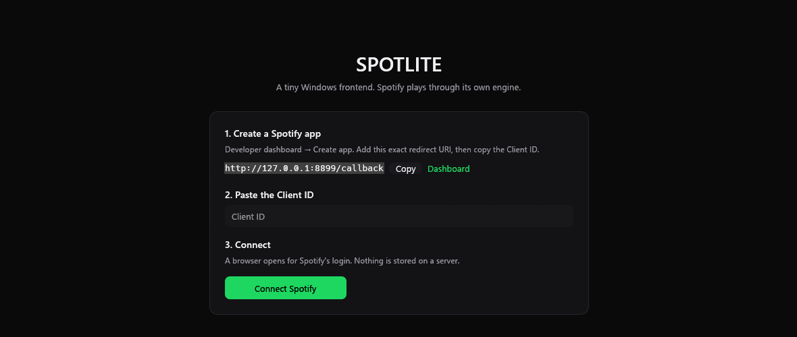
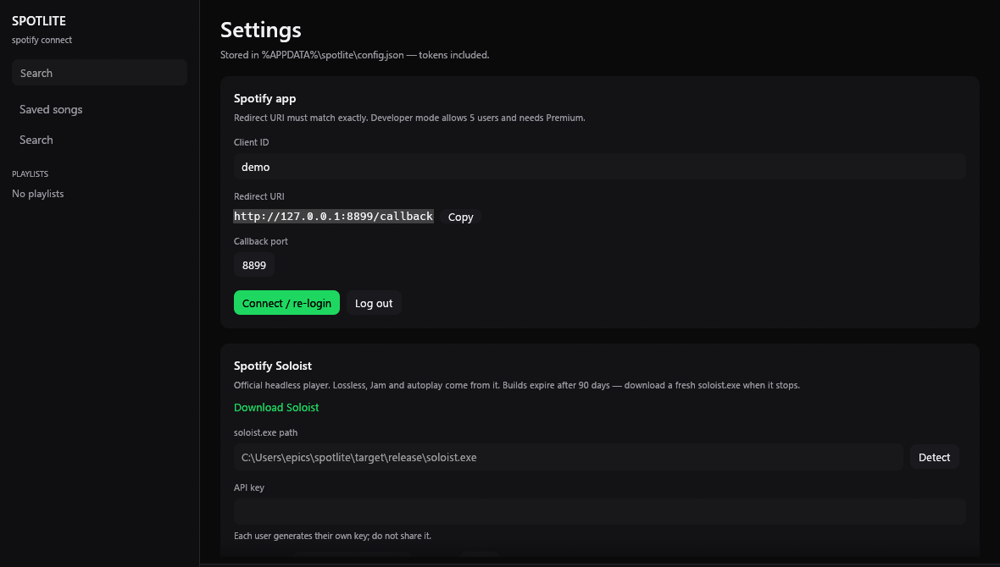

<div align="center">

# Spotlite

**A 6 MB Spotify frontend for Windows. Audio is Spotify Connect, so lossless works.**

Native Rust, no Electron, no webview, no server.

<a href="https://github.com/epicshawty/spotlite/releases/latest"></a>

[](https://github.com/epicshawty/spotlite/actions/workflows/ci.yml)
[](https://github.com/epicshawty/spotlite/releases/latest)
[](https://github.com/epicshawty/spotlite/releases)

[](LICENSE)
[](https://www.rust-lang.org)
[](https://github.com/epicshawty/spotlite/releases/latest)
[](https://github.com/epicshawty/spotlite/releases/latest)

**[Download](https://github.com/epicshawty/spotlite/releases/latest)** · **[Setup](#setup)** · **[Build](#build)**

</div>

## What it does

- **Lossless playback** — audio runs through Spotify Soloist, Spotify's own headless Connect client. The window only sends play/pause/seek/volume/queue commands, so it never decodes audio and never touches DRM.
- **Your library** — saved songs, saved albums, followed artists, playlists, search.
- **Full transport** — play a playlist from any track, skip, seek, volume, shuffle, repeat, queue, switch devices.
- **Edits** — save or remove a track, add a track to any playlist.
- **Local only** — OAuth over a loopback redirect; tokens stay in `%APPDATA%\spotlite\config.json`.

## What it doesn't

- No offline downloads. Spotify only allows those in its own apps.
- No podcast/audiobook browsing. Episodes play if you start them elsewhere.
- Followed editorial playlists show metadata only: Spotify returns contents only for playlists you own or collaborate on.
- DJ mixes and local files are out of scope.

## Requirements

- Windows 10/11 x64
- Spotify Premium (required for developer-mode apps and for Soloist setup)
- A Spotify developer app — one client ID, up to 5 users, no approval needed
- Spotify Soloist and its free per-user API key

## Setup

1. Create an app at [developer.spotify.com/dashboard](https://developer.spotify.com/dashboard). Add `http://127.0.0.1:8899/callback` as a redirect URI. Copy the Client ID.
2. Download [Spotify Soloist](https://developer.spotify.com/documentation/soloist/reference/downloads-and-updates) and put `soloist.exe` next to `spotlite.exe`.
3. Generate a Soloist API key from the same dashboard.
4. Run `spotlite.exe`, paste the Client ID and API key, press **Connect**.
5. In Settings, press **Start Soloist**. Open Spotify on your phone, select the `Spotlite` device once to pair it. Done.



## Build

```powershell
cargo build --release
```

Output is `target/release/spotlite.exe`. CI builds with MSVC; a GNU toolchain works locally when WinLibs' `dlltool` is on `PATH`.

```powershell
cargo test && cargo clippy --all-targets -- -D warnings
```

## Data

| Path | Contents |
|---|---|
| `%APPDATA%\spotlite\config.json` | Client ID, refresh token, Soloist key — treat it like a password |
| `%APPDATA%\spotlite\soloist\` | Soloist pairing state |
| `%LOCALAPPDATA%\spotlite\cache\` | Soloist playback cache |

## Notes

Spotify caps developer-mode apps at five users, ten search results per request (Spotlite pages through three), and rotates Soloist builds every 90 days. When Soloist stops starting, download a fresh `soloist.exe` — the app cannot update it for you.

## License

AGPL-3.0-or-later. Soloist is a Spotify binary with its own terms; it is not bundled or redistributed here.
